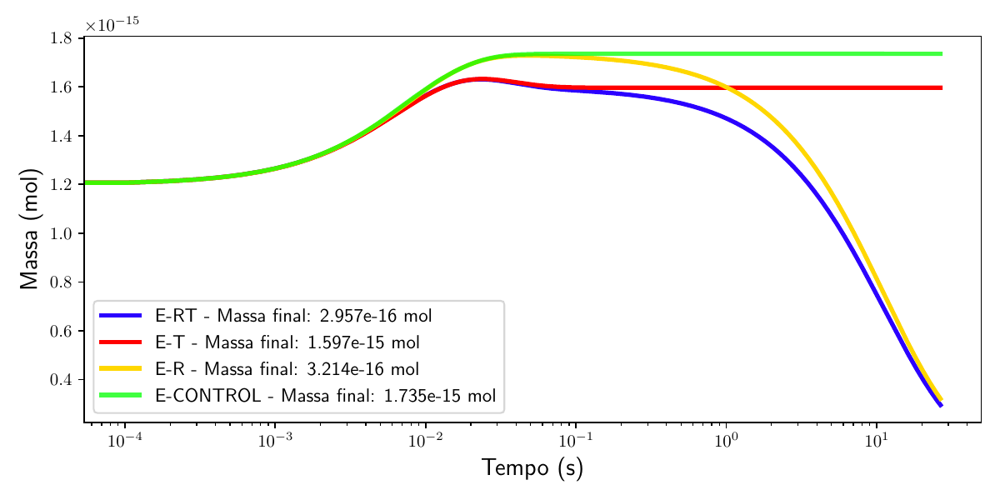
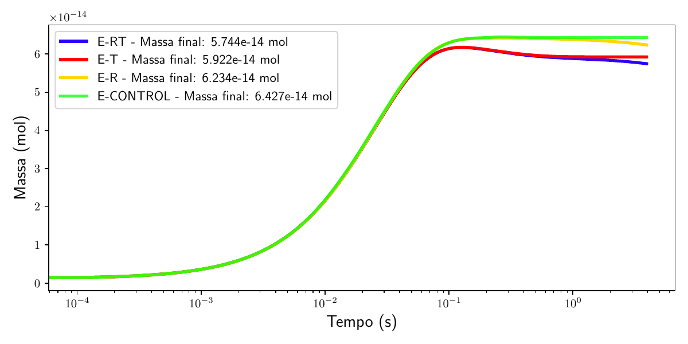
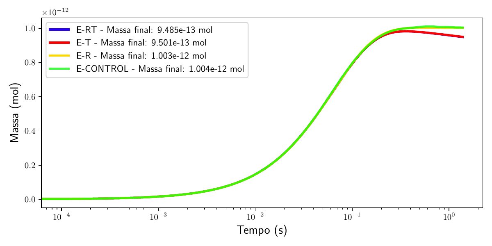
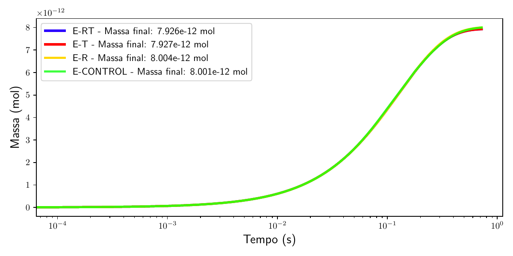

# IC1: Métodos matemáticos para resolver uma equação de difusão de massa em superfície esférica

Iniciação Científica · UFES · Edital Piic 2024/2025 · Orientador: Iury Angelo Gonçalves · Aluno: Emanuel Pinto Sampaio

Relatório final: [PDF](relatorio/Emanuel_relatório_final_2026_IC1.pdf) · Continuação: [IC2](https://github.com/emanuelpintosampaio/IC2)

## Resumo

Simulação da absorção de CO₂ por gotículas de espuma marinha. O raio r(t) e a temperatura T(t) da gotícula seguem decaimentos exponenciais (Andreas, 1989; 2005), e a massa de CO₂ m(t) é calculada pelo **método de Euler Backward** até a gotícula voltar ao mar. Foram feitos quatro experimentos, com gotículas de 30, 100, 250 e 500 µm e ondas de 6 m:

| E-CONTROL | E-R | E-T | E-RT |
|---|---|---|---|
| r e T constantes | só r varia | só T varia | r e T variam |

## Rodar no Google Colab

Abra um notebook em [colab.research.google.com](https://colab.research.google.com/), cole numa célula e execute:

```python
%cd /content
![ -d IC1 ] || git clone -q https://github.com/emanuelpintosampaio/IC1.git
%cd IC1/codigos
%run menu_colab.py
```

O menu pede o raio da gota e o que mostrar: o gráfico dos quatro experimentos, as massas finais por Euler Backward, o tempo de vida da gota, a solução analítica ou a figura do relatório.

## Resultados

| 30 µm | 100 µm |
|---|---|
|  |  |
| **250 µm** | **500 µm** |
|  |  |

## Conclusão

O efeito das variações de raio e temperatura na absorção de CO₂ diminui à medida que a gotícula aumenta. Comparando E-RT com E-CONTROL, a massa final cai **83%** para 30 µm, **10,6%** para 100 µm, **5,5%** para 250 µm e **menos de 1%** para 500 µm. Ou seja, essas variações são importantes para gotículas pequenas e quase irrelevantes para as grandes, mesmo com ondas de 6 m.

## Arquivos

- `codigos/`: scripts em Python e módulos físicos. Principais: `main_code.py` e `2)-EULER_IMPLICITO(BACKWARD)_SIMPLIFICAÇÕES.py` (Euler Backward), `IC1_GRAFICOS.py` (gráfico dos quatro experimentos), `tau_f.py` (tempo de vida), `graph_req.py` (raio de equilíbrio) e `edo_fator_integrante.py` (solução analítica).
- `figuras_relatorio/`: figuras do relatório.
- `relatorio/`: relatório final em PDF.

> Os parâmetros de referência (corretos) são os do [TCC](https://github.com/emanuelpintosampaio/TCC).
